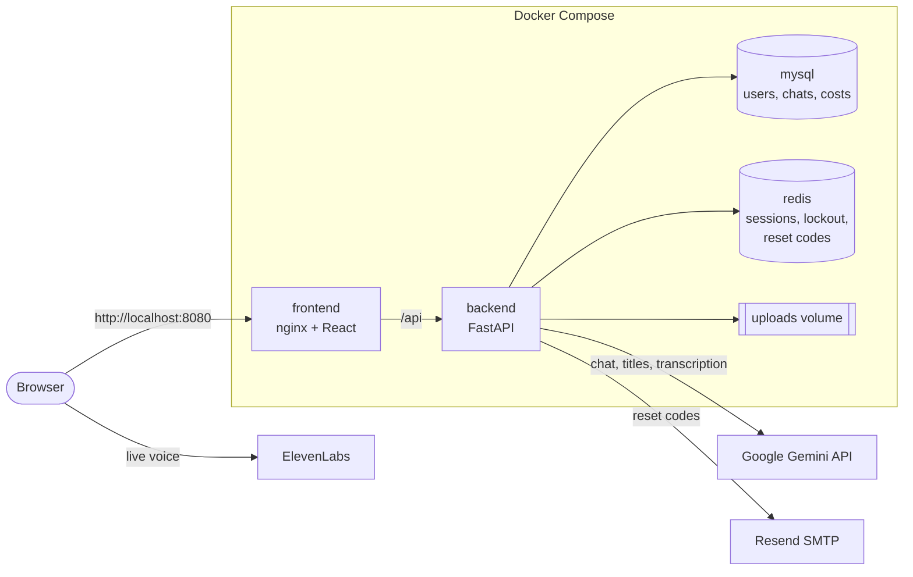

# Gemini Chat

A multi-user AI chat web app built with **React, FastAPI, MySQL and Redis**, all started with
one Docker Compose command. Users sign in, chat with **Google Gemini** using text, images,
PDFs and voice memos, and can talk out loud with an **ElevenLabs** voice agent. Admins manage
users and see what every chat costs on a billing dashboard.

> This is a demo / training project, not a commercial service.

## Demo

<!-- Add a demo video or GIF here, for example: -->
<!-- https://github.com/user-attachments/assets/your-video-id -->

| Login | Chat | Billing |
|---|---|---|
|  |  |  |

*Screenshots coming soon: put them in `docs/screenshots/`.*

## Features

**Accounts and security**
- Email + password login; passwords are stored as **bcrypt** hashes
- **Keep me signed in** for 30 days: an HttpOnly cookie, only its SHA-256 hash is stored
- **Lockout** after 5 wrong passwords in 15 minutes
- **Forgot password** with a 6-digit code sent by email (hashed, 15 minutes, 5 tries, single use)
- User and admin roles, checked on the server for every request

**Chat**
- Several chats per user, grouped by date, with rename, delete and search
- **Thinking**, **Streaming** (word by word) and **Search** (Google Search grounding) options
- Uploads of images, PDFs and audio (up to 20 MB each), including drag and drop
- **Voice memos** recorded in the browser and transcribed by Gemini
- An automatic 3–6 word title after the 5th message
- Like, dislike and copy on every answer
- Token, cost and response-time tracking for every answer

**Voice agent**
- Live voice conversation with an ElevenLabs agent, with an animated orb, captions, mute and end

**Admin**
- User management: create users, change passwords and roles, delete a user with all their data
- Billing dashboard: 8 KPIs, cost per day, cost by token type, feature usage, a sortable sessions table and a date filter

**Design**
- Dark "ember" theme: flame orange, amber sparks, big condensed headings
- Motion: rising embers, spark bursts, a winking logo, dancing letters, tilting cards (all off with "reduced motion")
- Self-hosted fonts, phone layout, 44px touch targets, privacy / terms / cookie pages

## Architecture



Only the frontend is published to your computer. MySQL, Redis and the backend stay inside
Docker's private network. nginx passes every `/api` call to the backend, without buffering,
so answers stream word by word.

### What Redis is used for

| Key | Purpose | Expires |
|---|---|---|
| `session:<hash>` | Which user a login cookie belongs to | 1 day, or 30 days with "Keep me signed in" |
| `user_sessions:<id>` | A user's sessions, so a password change logs them out everywhere | 30 days |
| `login_fail:<email>` | Wrong-password times for the lockout | 15 minutes |
| `reset:<user id>` | Hashed reset code and its wrong tries | 15 minutes |
| `reset_sent:<user id>` | One reset email per minute | 60 seconds |

### How a message is answered

1. The browser sends the text, options and files to `POST /api/chat`.
2. The backend checks the files and the chat's owner, then calls Gemini with the conversation.
3. The answer streams back as JSON lines.
4. Only after Gemini has answered is anything saved, so a failed message leaves nothing behind.

## Tech stack

| Layer | Technology |
|---|---|
| Frontend | React 19, React Router 7, Vite 7, react-markdown, hand-written CSS |
| Backend | Python 3.12, FastAPI, Uvicorn |
| AI | Google Gemini API (`google-genai`) |
| Voice | ElevenLabs Agents (`@elevenlabs/client`) |
| Database | MySQL 8.4 |
| Cache / security | Redis 7 (saved to disk) |
| Email | Resend over SMTP |
| Web server | nginx 1.27 |
| Containers | Docker Compose: 4 services, 3 volumes |

## Run it

You need [Docker Desktop](https://www.docker.com/products/docker-desktop/) running.

```bash
git clone https://github.com/<your-username>/gemini-chat.git
cd gemini-chat
cp .env.example .env        # then fill in the values (see below)
docker compose up --build
```

Open **http://localhost:8080** and sign in with `ADMIN_EMAIL` and `ADMIN_PASSWORD` from `.env`.
The database tables and the first admin are created automatically on the first start.

| Command | What it does |
|---|---|
| `docker compose up -d` | Start in the background |
| `docker compose down` | Stop (your data is kept) |
| `docker compose down -v` | Stop and **delete all data** |
| `docker compose logs -f backend` | Watch the backend's log |
| `docker compose exec backend python -m app.set_password you@example.com` | Set a password from the terminal |

API docs while it runs: http://localhost:8080/api/docs

## Environment variables

Copy `.env.example` to `.env`. The `.env` file holds your secrets and is never committed.

| Variable | What it is |
|---|---|
| `APP_PORT` | Port of the website on your computer (default 8080) |
| `TZ` | Your timezone, so "today" matches your clock (e.g. `Europe/Berlin`) |
| `API_KEY` | Your Google Gemini API key |
| `MODEL` | The Gemini model name |
| `DB_NAME`, `DB_USER` | MySQL database and user (created automatically) |
| `DB_PASSWORD`, `DB_ROOT_PASSWORD` | MySQL passwords: pick long random values |
| `REDIS_PASSWORD` | Redis password: letters and digits only |
| `ADMIN_USERNAME`, `ADMIN_EMAIL`, `ADMIN_PASSWORD` | The first admin, created when the database is empty |
| `SMTP_HOST`, `SMTP_PORT`, `SMTP_USER` | Resend SMTP settings (defaults are filled in) |
| `SMTP_PASSWORD` | Your Resend API key (starts with `re_`) |
| `MAIL_FROM` | Sender of the reset emails |
| `ELEVENLABS_AGENT_ID` | ID of a public ElevenLabs agent |

While testing, Resend only delivers email to the address you signed up with.

## Project structure

```
docker-compose.yml      the four services
.env.example            template for .env
backend/
  Dockerfile
  app/main.py           start-up: tables, first admin, routes
  app/db.py             every MySQL query
  app/store.py          everything in Redis
  app/auth.py           passwords, sessions, reset codes, delete user
  app/routes/           login, chat (Gemini + uploads), admin (users + billing), voice
  app/pricing.py        Gemini prices
frontend/
  Dockerfile            builds React, then serves it with nginx
  nginx.conf            the site + the /api pass-through
  src/pages/            Login, Chat, Billing, Admin, Voice, legal pages
  src/components/       sidebar, voice orb, charts, recorder, fire effects
  src/style.css         the whole design
```

## Pricing used by the billing dashboard

Prices per 1M tokens: input $2.00, cached input $0.10, output and thinking $10.00, doubling
from Dec 1, 2026. Each day is priced with that day's rates. Edit `backend/app/pricing.py` to change them.

## License

No license has been chosen yet. Fonts: Inter and Anton, SIL Open Font License.
